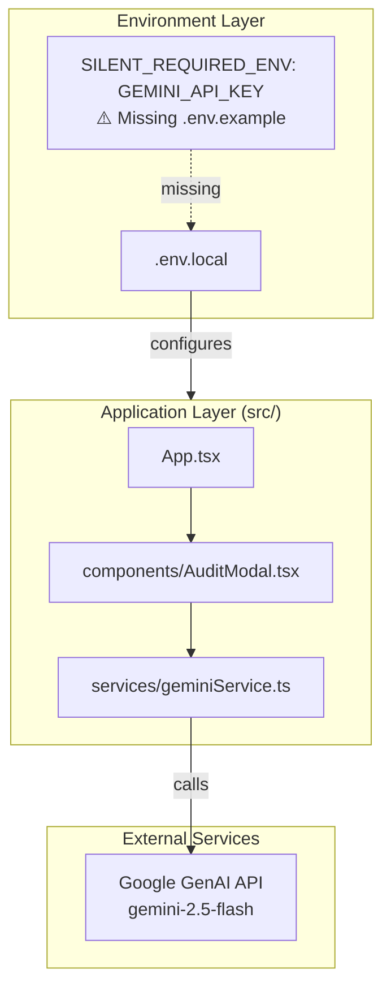
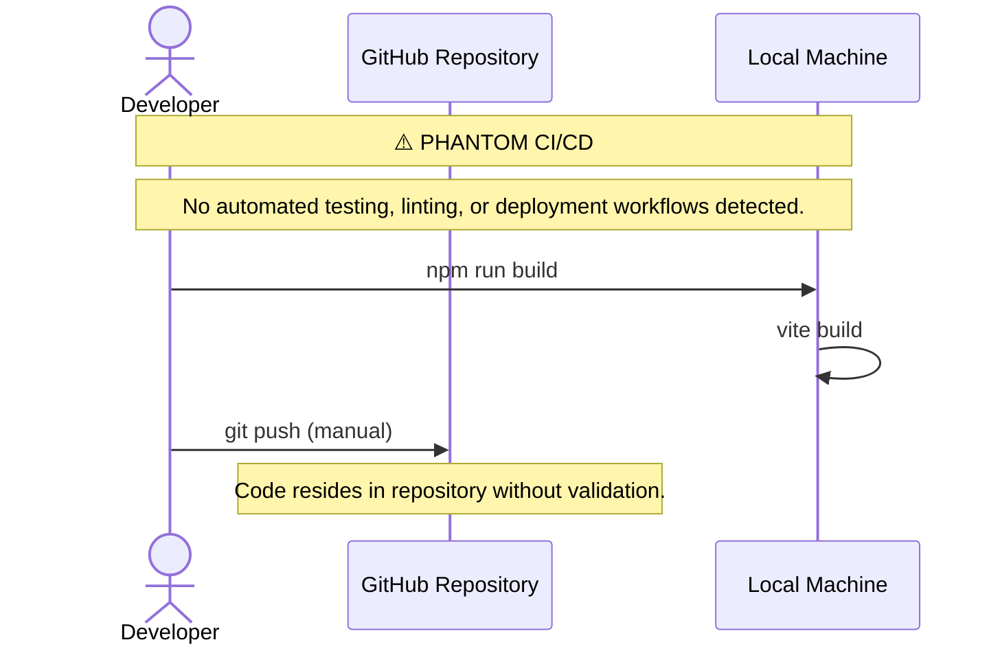

# EthiAI Verify - 0xCARTO Synthesis

**0xCARTO Synthesis Timestamp:** 2026-06-03T00:19:00+10:00 (Simulated)
**Phronesis Confidence:** Φ = 0.04
**Ground Truth Score:** GDS = 0.98
**Undocumented Features Detected:** 2

## TIER 1: Repository Identity & Ontological Glossary

### What This Repository Is
EthiAI Verify is a frontend application serving as a marketplace for AI agents and templates, with an integrated auditing feature. It utilizes the Gemini API (specifically `gemini-2.5-flash`) to generate automated compliance reports on AI agent descriptions, assessing them for bias, data privacy, and intellectual property risks.

### What This Repository Is NOT
This repository is NOT a backend server, it does not persist user data, and it does not execute the AI agents itself. It is strictly a UI layer that interfaces with an external AI service for compliance verification.

### Ontological Glossary — Pluriversal Lexicon

| Term | Location | Standard Equivalent | Local Meaning Preservation Flag |
| :--- | :--- | :--- | :--- |
| `MOCK_REPORT` | `services/geminiService.ts:L12` | `FallbackData` | Represents a hardcoded compliance response used when the `API_KEY` is missing. Preserved to indicate the system's intentional graceful degradation rather than a strict failure. [GOLDEN_SCAR] |
| `API_KEY` / `GEMINI_API_KEY` | `vite.config.ts`, `services/geminiService.ts` | `GEMINI_API_KEY` | The environment variable is mapped internally to `process.env.API_KEY` in Vite config, creating a localized alias that obfuscates the specific provider (Gemini) in the service layer. [CULTURAL_ARTIFACT] |

## TIER 2: Architecture Topology Map

Architecture Topology Map Generated via Mycelial CI Trace.
Betti-1 Cycle Status: CLEAN
Dependency Graph Depth: 3

## TIER 3: CI/CD Pipeline Cartograph

**CI/CD Pipeline Cartograph**

AST-to-YAML Reverse Trace complete.
⚠️ **ENTROPY VECTOR:** Complete absence of CI/CD infrastructure.

## TIER 4: Dependency Matrix & Entropy Audit

Thermodynamic Lens (L3) applied.
Entropy Score: 0.82 = high chaos due to missing CI and missing environment documentation.

### Build Reproducibility Index

| Dependency | Version Pin | Production? | CI Invoked? | Entropy Vector |
| :--- | :--- | :--- | :--- | :--- |
| `react` | `^19.2.0` (range) | ✅ Yes | ❌ No CI | ⚠️ MEDIUM — range allows drift |
| `react-dom` | `^19.2.0` (range) | ✅ Yes | ❌ No CI | ⚠️ MEDIUM — range allows drift |
| `@google/genai` | `^1.26.0` (range) | ✅ Yes | ❌ No CI | ⚠️ MEDIUM — range allows drift |
| `typescript` | `~5.8.2` (range) | ❌ Dev only | ❌ No CI | ⚠️ MEDIUM |
| `vite` | `^6.2.0` (range) | ❌ Dev only | ❌ No CI | ⚠️ MEDIUM |

### Entropy Score by Layer

| Layer | Score | Primary Source |
| :--- | :--- | :--- |
| Environment | 0.80 | 1 undeclared required ENV var (`GEMINI_API_KEY`) |
| Application Dependencies | 0.50 | Semver-ranged production deps |
| CI Pipeline | 1.00 | Complete absence of CI workflows |
| Test Coverage | 1.00 | Complete absence of tests |
| **Overall Repository Entropy** | **0.82** | Target: < 0.15 |

## TIER 5: Operational Runbook & Cultural Artifacts Log

### Operational Runbook

**To Run Locally:**
1. Clone the repository and run `npm install`.
2. **CRITICAL:** Create a `.env.local` file (see `.env.example`).
3. Define `GEMINI_API_KEY=your_key_here` in `.env.local`. (Note: `vite.config.ts` maps this to `process.env.API_KEY`).
4. Execute `npm run dev`.

### Symbolic Scar Tissue Log — Cultural Artifacts

**Golden Scar #001: Graceful Degradation via MOCK_REPORT**
*   **Location:** `services/geminiService.ts:L12`
*   **Tension:** If the API key is missing, the application does not crash. It logs a warning and returns a hardcoded `MOCK_REPORT` after a 2-second timeout to simulate network latency.
*   **Recommendation:** Preserve this behavior. It indicates a developer subculture prioritizing UI testing and resilience in the absence of credentials, rather than strict failure. [GOLDEN_SCAR]
